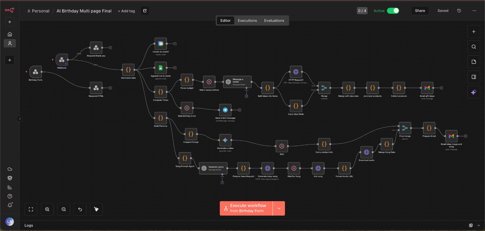
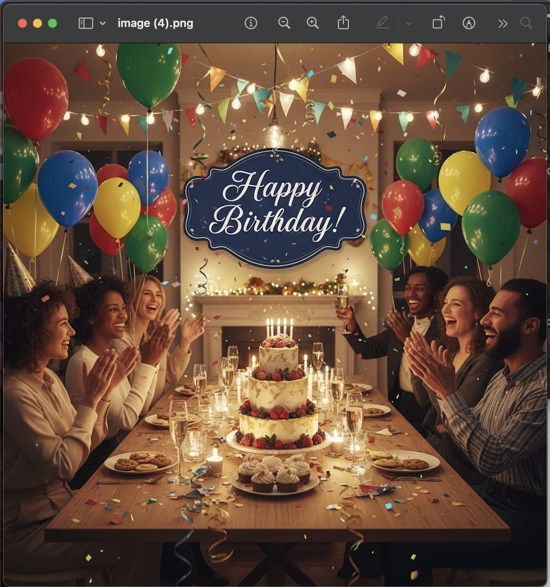
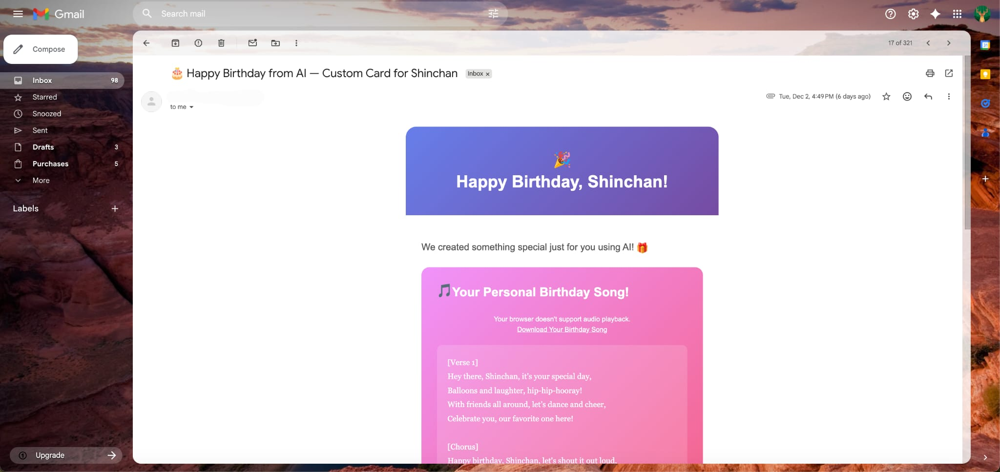
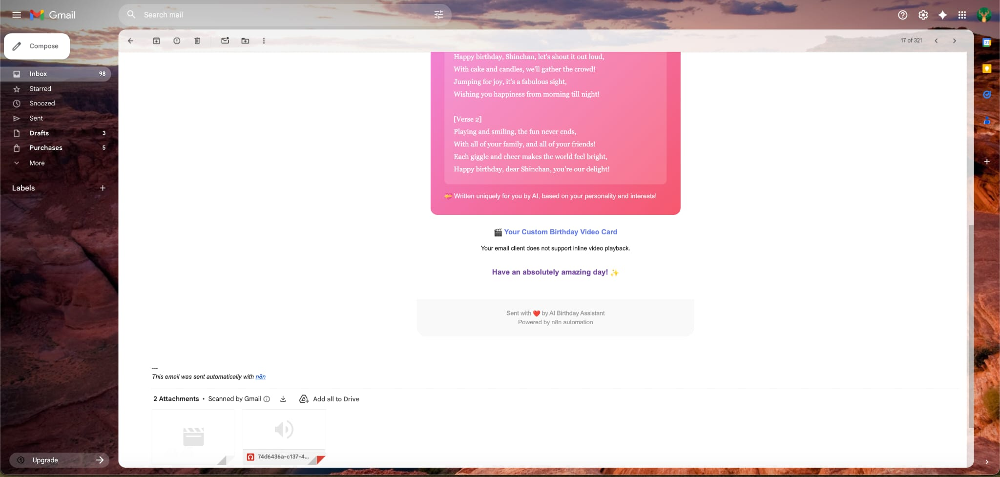
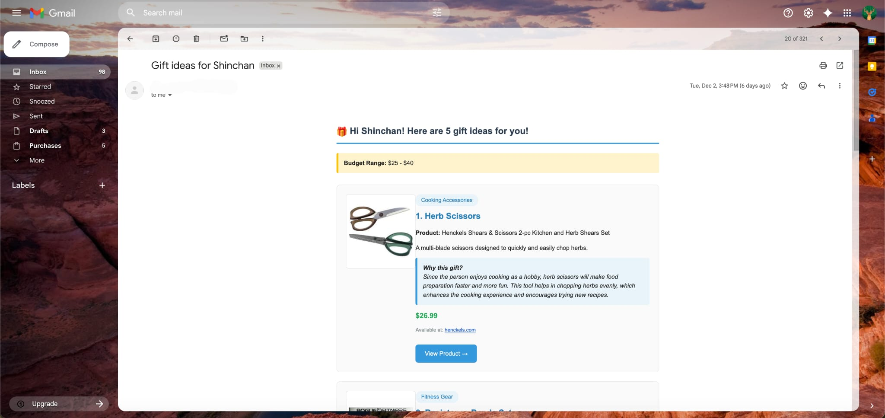
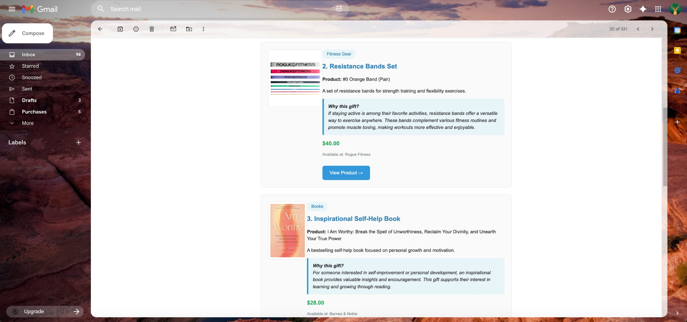
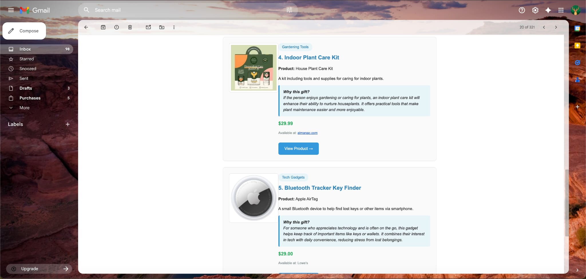
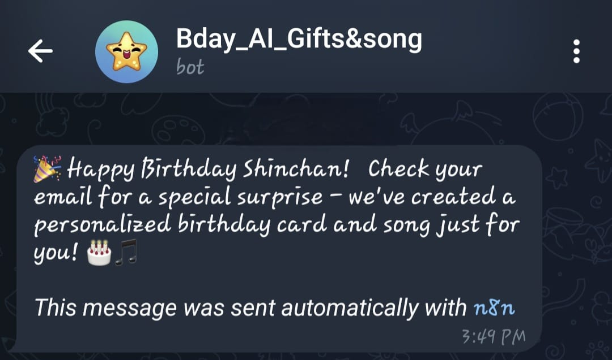

# 🎂 AI-Powered Birthday Gift & Greeting Automation System

> An end-to-end automation that turns a simple form submission into a fully personalized birthday experience — AI-generated song, image card, video, curated gift recommendations, and multi-channel delivery. Zero manual effort on the day.

---

## 🎯 What This Does

When someone submits a birthday form, the system automatically:

1. **Profiles the recipient** — builds a persona from their hobbies, personality, and preferences using Gemini AI
2. **Generates a custom birthday song** — lyrics written by GPT, music produced by Suno API, delivered as an MP3 attachment
3. **Creates a personalized image card** — AI-generated visual via KIE API, styled for the recipient
4. **Produces a birthday video** — generated and attached alongside the card
5. **Curates 5 gift ideas** — web-sourced, budget-filtered, categorized, and formatted as a rich HTML email
6. **Sends everything automatically** — HTML email with GIF preview + MP3/MP4 attachments via Gmail, plus a Telegram notification

---

## 📸 Project Demo

### n8n Workflow Overview


### AI-Generated Birthday Card


### Email: Birthday Song & Card Delivery



### Email: Personalized Gift Recommendations




### Telegram Notification


---

## 🏗️ System Architecture

```
Birthday Form (Webhook)
        │
        ▼
  Normalize Data  ──────────────────────────────────────────────┐
        │                                                        │
        ├──► Google Calendar (create event)                      │
        │                                                        │
        ├──► Google Sheets (log record)                          │
        │                                                        │
        └──► Compute Times & Build Persona                       │
                    │                                            │
        ┌───────────┴──────────────────┐                         │
        │                              │                         │
        ▼                              ▼                         │
  [2 Weeks Before Birthday]     [Morning of Birthday]            │
  Gift Recommendation Flow      Song + Card + Telegram           │
        │                              │                         │
        ├── Gemini: Gift Ideas         ├── GPT: Song Lyrics      │
        ├── Serp API: Product Search   ├── Suno: Music Gen       │
        ├── Merge & Rank Products      ├── KIE: Image Card       │
        └── Send Gift HTML Email       ├── Gemini: Video         │
                                       ├── Download + Attach     │
                                       ├── Telegram Notify       │
                                       └── Send Birthday Email   │
```

---

## ⚙️ Technical Highlights

### Async Polling for AI Media Generation
Suno's music generation API is asynchronous — the workflow submits the request, then polls with a `Wait` node until the audio is ready before downloading and attaching the binary MP3.

### JavaScript Data Normalization
Raw webhook data from the form is cleaned and normalized via a custom JS node — parsing budgets, formatting dates, standardizing field names — before any downstream processing.

### Persona-Aware Prompting
A dedicated `Build Persona` node constructs a structured personality profile (hobbies, tone, interests) that is passed as context into every AI generation step, keeping the song, card, and gift recommendations coherent and personal.

### Binary Media Handling
The workflow downloads MP3 and MP4 files as binary streams, carries them through the workflow, and attaches them directly to the Gmail node — no intermediate file storage required.

### Dual Email Strategy
Two separate HTML emails are sent with different timing:
- **Gift ideas email** (2 weeks before) — gives time to order
- **Birthday greeting email** (day-of, 8 AM) — song, card, video

---

## 🛠️ Tech Stack

| Category | Tools |
|---|---|
| Orchestration | n8n |
| AI - Text & Persona | Gemini AI, OpenAI GPT |
| AI - Music | Suno API |
| AI - Image & Video | KIE API |
| Product Search | Serp API |
| Delivery | Gmail API, Telegram Bot API |
| Data Storage | Google Sheets |
| Scheduling | Google Calendar API |
| Language | JavaScript (n8n Function nodes) |
| Protocols | Webhooks, REST APIs, Async Polling |
| Format | HTML Email, MP3, MP4, GIF |

---

## 📁 Repository Structure

```
ai-birthday-automation/
├── workflow/
│   └── AI_Birthday_Multi_page_Final.json   # Full n8n workflow — import this
├── assets/
│   ├── screenshots/                        # Workflow + email output demos
│   └── sample-output/                      # Sample AI-generated card
├── docs/
│   └── setup.md                            # Configuration guide
└── README.md
```

---

## 🚀 Getting Started

### Prerequisites
- [n8n](https://n8n.io/) instance (self-hosted or cloud)
- API keys for: Gemini, Suno, KIE, Serp API, OpenAI
- Gmail account with OAuth configured in n8n
- Telegram Bot token (via @BotFather)
- Google Sheets + Calendar connected via OAuth

### Import & Run

1. Clone this repo
   ```bash
   git clone https://github.com/YOUR_USERNAME/ai-birthday-automation.git
   ```

2. Open your n8n instance → **Workflows** → **Import from File**

3. Select `workflow/AI_Birthday_Multi_page_Final.json`

4. Set up credentials for each service in n8n's credential manager

5. Configure your environment variables (see `docs/setup.md`)

6. Activate the workflow and submit a test entry via the Birthday Form webhook

---

## 💡 Key Engineering Decisions

**Why async polling instead of webhooks for Suno?**
Suno's generation can take 30–90 seconds. Webhooks would require exposing a public callback URL and managing state across two separate trigger events. Polling inside a single workflow execution is simpler, more reliable, and keeps all the logic in one place.

**Why two separate emails?**
Gift recommendations sent 2 weeks early give the recipient's friends time to actually buy something. Bundling everything into one email on the birthday would make the gift ideas useless.

**Why Serp API for product search?**
The gift ideas needed to link to real, purchasable products with images and prices. A pure LLM would hallucinate URLs. Serp API returns real product listings that the workflow then re-ranks using AI.

---

## 📊 Results

- ✅ Full end-to-end execution: webhook → dual email delivery
- ✅ Personalized AI music, image, and video per recipient
- ✅ 5 categorized, budget-filtered gift recommendations with real product links
- ✅ Telegram push notification on birthday morning
- ✅ All media handled as binary streams — no external file storage

---

## 🔗 Related Projects

Check out my other automation and AI projects:
- [Customer Review Sentiment Analyzer](#) — n8n + OpenAI + Power BI
- [RPA + AI Business Operations Automation](#) — Invoice parsing, email triage, weekly reporting
- [Conversational BI Assistant](#) — Natural language queries over business data

---

*Built with n8n, Gemini AI, Suno, and too much curiosity about what you can actually automate.*
